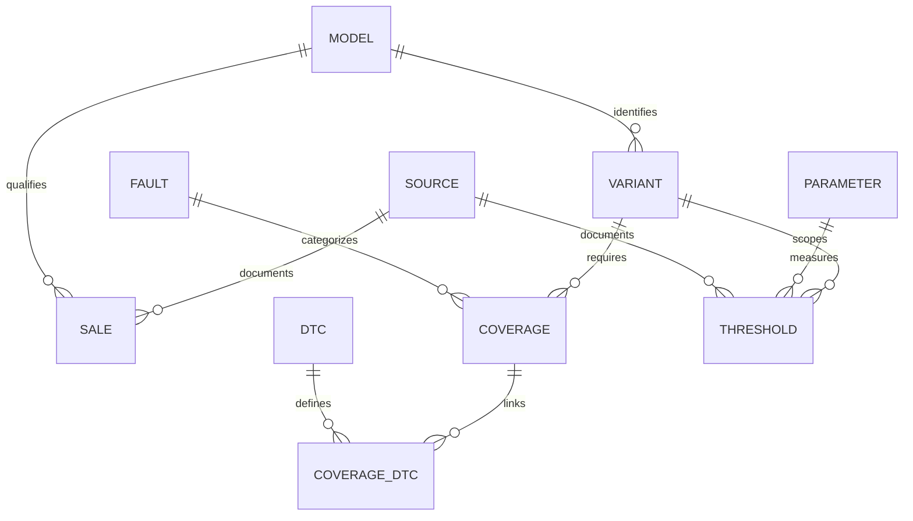

# Catálogo Europa/EE. UU. — entrega de revisión

Rama `data-eu-us-2025`; no publicada en Render. Datos observados el 26.10.2026.
Año natural de selección: **2025**. No se infiere año-modelo a partir del año de venta.

## 1. QA y release

Veredicto para la ampliación diagnóstica completa: **Not ready**. Hay 14 modelos
comerciales elegibles, pero cero variantes técnicas verificadas, cero umbrales OEM
y cero asociaciones DTC-modelo documentadas en el catálogo nuevo. La estructura,
importador y vista informativa son una entrega de muestra con límites explícitos;
no certifican cobertura de todo el parque ni capacidad de diagnosticar todas las averías.
Las ocho recomendaciones de neumáticos de la entrega anterior siguen separadas.

Evidencia automatizada en `reports/fleet2025/`: tests, puertas de release,
benchmark, navegador y contenedor. Las limitaciones son parte de las puertas:

- JSON Schema Draft 2020-12: campos y tipos estrictos, fechas, DTC, claves,
  estados, unidades y metadatos. Se rechazan claves JSON repetidas y NaN/Inf.
- Semántica: 49 y 50 excluidos; 51 incluido; ventas del año natural completo
  anterior; nunca equivaler matriculaciones/entregas a ventas. Modelos y variantes
  se separan y las ventas de marca/familia no acreditan un modelo distinto.
- SQL: claves foráneas, identidades únicas, columnas de parámetros únicas,
  restricciones de valores, `foreign_key_check` e `integrity_check`.
- Umbrales: una variante exacta y mercado definido, unidad y condiciones,
  vigencia sin solapamientos, fuente técnica y derechos de reutilización coherentes.
  No se permiten números en registros `missing_oem`. No se convierten unidades.
- DTC: códigos genéricos, fabricante, ECU y definición/categoría separados.
  Se rechazan enlaces OEM entre marcas distintas. Un DTC no identifica de forma
  unívoca una pieza averiada. Los ejemplos regulatorios no se asocian a modelos.
- Operación: importación fallida conserva byte por byte la base previa; consultas
  parametrizadas, artefacto de solo lectura y protección contra catálogos sintéticos.
- Regresión: formulario sin archivos, cambio de idioma, análisis y CSV internos
  antiguos; caída del catálogo informativo no impide introducir mediciones.
- Navegador: Chromium, es/en/de, 1440 y 390 px. No equivale a certificación WCAG,
  prueba en todos los dispositivos, Firefox/Safari ni ensayo de carga en Render.

Comandos desde `mantenimiento-predictivo/`, con Python 3.12:

```sh
python -m pip install -r requirements.txt
python -m pip check
python scripts/build_fleet_catalog.py
python -m unittest discover -s tests -v
python scripts/check_fleet_release.py --profile preview
python scripts/check_fleet_release.py --profile diagnostic
python -m streamlit run app.py
```

El último gate devuelve **2** de forma intencionada: la ampliación diagnóstica y
cobertura completa aún están bloqueadas. Un gate de preview correcto valida la
muestra de datos, no autoriza por sí solo desplegar ni anuncia cobertura global.

## 2. Arquitectura y operación

`schemas/fleet-catalog-v1.schema.json` define el contrato JSON ejecutable y
`schemas/fleet-catalog-v1.sql` el esquema SQLite ejecutable. PostgreSQL sería una
migración posterior (JSONB, roles y backups), no una infraestructura ya instalada.
Se reutiliza `jsonschema==4.26.0`, que ya estaba fijado en el lock; se declara ahora
como dependencia directa. `sqlite3` forma parte de Python. No se añade una librería.



Modelo comercial, generación, motor, transmisión, batería, software ECU, mercado
y año-modelo tienen campos separados. Las variantes del ejemplo permanecen
pendientes; no se asignan especificaciones de motor a toda una familia comercial.

Selección: `eligible` se calcula, no se acepta un booleano importado del proveedor.
Europa usa la política versionada `europe-us-v1` (países y territorios europeos,
más Chipre y Turquía para el alcance operativo). Un agregado rotulado Europa por
el fabricante conserva esa denominación; no significa UE-27. Francia es un
subconjunto europeo que permite demostrar >50 sin sumarla a un total Europa.
No se suman países y agregados superpuestos. El agregado TME con Asia/Israel no
se utiliza como prueba de ventas exclusivamente europeas.

Pipeline implementado: JSON curado → validación → SQLite temporal con índices →
comprobaciones de integridad → `fsync` → `os.replace`. El metadato interno conserva
hash del bundle y fecha. El build es offline, de escritor único y no se ejecuta en
una petición Streamlit. La base pública se abre con `mode=ro&immutable=1` y se
cierra al terminar la consulta. La promoción externa debe distribuir el archivo
completo e inmutable; no modificarlo en vivo ni colocarlo en un volumen compartido
con escrituras concurrentes. Una conexión ya abierta sigue leyendo su snapshot.

Índices: identidad de modelo; modelo/mercado/año/motor; elegibilidad/año/modelo;
DTC/namespace/marca; variante/estado de cobertura; variante/parámetro/condición/estado.
Los límites de consulta están acotados. `lookup_thresholds()` exige coincidencia
única y ventas elegibles del año anterior a la fecha consultada. No usa fallback.

`operations/fleet-pipeline.json` describe comandos, etapas y bloqueos. No hay
scheduler desplegado, extracción masiva activa ni conexión a proveedores de pago.
La actualización propuesta es semanal para fuentes autorizadas y anual para
recalcular elegibilidad; queda pendiente instalarla en CI/worker tras revisar
licencias y permisos. Los logs deben registrar conteos, códigos y hashes; nunca
mediciones, VIN, CSV o credenciales. No hay persistencia nueva de datos de usuarios.

### Estado real de complementos

Se aplicó **Web App QA & Release Copilot** para revisión de riesgos y evidencia.
Se repartieron investigación de fuentes, revisión de arquitectura y revisión
DTC entre agentes, con pruebas independientes y correcciones de integridad.

**Genie**: el complemento mencionado no expone herramientas/skill utilizables en
esta sesión. No se afirma haber ejecutado consultas ni automatizaciones con él.

**ZzzOps**: se leyeron `review-zzzops-policy` y `execute-zzzops`. El primero exige
«Follow `../../rules/INITIALIZATION.md`» y «Run `init inspect` once»; los recursos
referenciados no son accesibles y no existe CLI/herramienta ZzzOps invocable.
Por ello no se inicializó ni aprobó su política, no se ejecutó su loop y no se
inventó una tabla de política. Las operaciones de esta entrega son comandos del
repositorio autorizados por la petición, independientes de ZzzOps. No se envió
feedback externo. Fuente: `skill://plugins_6a7892fe4c548191a9e0dbfb8ac2c987/review-zzzops-policy/SKILL.md`.

## 3. Dataset extendido y tres ejemplos

El bundle importable es `catalog/fleet2025/catalog.json`; la muestra autocontenida
para tres modelos es `examples/fleet2025_three_models.json`. Ambas siguen el mismo
contrato. Se verificaron citas exactas de ventas contra el HTML normalizado;
los hashes conservan las respuestas originales, no implican licencia comercial.

| Modelo | Territorio de la cifra | Ventas 2025 | Referencia |
|---|---|---:|---|
| Renault Clio 5 | Europa, según Renault | 243.401 | [Renault, resultados 2025](https://media.renault.com/renault-brand-achieves-10-global-passenger-car-sales-growth-in-2025-driven-by-successful-product-offensive/) |
| Renault Kangoo VAN | Francia, segmento comercial | 24.405 | [Renault Francia, resultados 2025](https://media.renault.com/resultats-commerciaux-2025-succes-des-nouveaux-produits-strategie-commerciale-robuste-et-leadership-technologique-renforcent-la-domination-de-renault-sur-le-marche-francais/) |
| Subaru Forester | Estados Unidos | 175.070 | [Subaru, Dec-25 YTD](https://media.subaru.com/pressrelease/2410/subaru-america-reports-december-2025-year-end-sales) |

Otros once: Subaru Ascent, BRZ, Crosstrek, Impreza, Legacy, Outback, Solterra y WRX;
Renault Scenic E-Tech electric, Trafic y Master. En Master no se presupone reparto
ligero/pesado: clase `commercial_unspecified`. No hay cobertura técnica confirmada
de vehículos pesados en esta entrega. El parque completo y su denominador faltan.

Cada modelo tiene una matriz de **cobertura requerida**, no una lista de averías
confirmadas: mecánica; electrónica/ECU/BCM/CAN/sensores/actuadores/ADAS; térmica y
DPF/GPF/SCR; vibración/lubricante/holguras/fatiga; DTC. Los componentes enumerados
no prueban que una variante concreta equipe esos sistemas. Hay 25 parámetros con
unidades: los 17 de automoción previos y ocho de telemetría/diagnóstico adicional.
Las restricciones físicas generales tampoco son límites OEM.

Ejemplo de referencia deliberadamente no utilizable para diagnóstico:

```json
{
  "variant_id": "subaru-forester-identity-pending",
  "parameter_id": "oil_pressure_bar",
  "unit": "bar",
  "lower": null,
  "upper": null,
  "status": "missing_oem",
  "source_id": null
}
```

Es un fragmento: el archivo completo contiene las condiciones, vigencia, motivo,
identidad y campos exigidos por el esquema. No se sustituye lo desconocido por
presiones, temperaturas o desgaste «habituales». La aceleración RMS en g permanece
separada de la velocidad vibratoria en mm/s; no se convierte una en otra.

DTC verificados: [40 CFR 86.1806-17(b)(1)](https://www.ecfr.gov/current/title-40/chapter-I/subchapter-C/part-86/subpart-S/section-86.1806-17)
cita **P0456, P04EE y P04EF** como ejemplos de categoría EVAP «very small leak».
No se verificaron sus definiciones SAE completas ni su aplicabilidad a estos
modelos. La condición reglamentaria de ensayo de 0,020 pulgadas **no** se incluye
como umbral de sensor predictivo. Los enlaces DTC-modelo y códigos OEM faltantes
permanecen vacíos. No se adquirió una licencia SAE/ISO ni de bases técnicas OEM.

## 4. Despliegue y escalabilidad

1. Mantener el despliegue actual mientras se revisa esta rama. Ejecutar build,
   tests y gates antes de promover el artefacto. El gate de diagnóstico completo
   debe seguir bloqueando esta muestra.
2. Render debe incluir `fleet_catalog.py`, `fleet_resources.py`, `schemas/`,
   `catalog/fleet2025/` y los locales; Dockerfile y allowlist están actualizados.
   Usuario no privilegiado y puerto `$PORT` se conservan. Ninguna API key en imagen.
3. El build completo del Dockerfile desde Python slim no se repitió por el espacio
   de disco disponible. Se construye una imagen de validación sobre la imagen
   previa con las mismas dependencias, copiando los módulos/datos/esquemas finales,
   y se ejecuta con 512 MiB/1 CPU. Esto no sustituye un build limpio de release.
4. Rollback: conservar commit e imagen anteriores y artefacto de catálogo por hash.
   Una importación fallida ya deja intacto el anterior. Tras una publicación futura,
   comprobar UI es/en/de, ausencia de cargador, ámbito de cifras, hash interno y
   errores. No basta HTTP 200 ni un `git push` para afirmar que funciona.
5. Para crecer: descargas por páginas/modelos desde proveedores autorizados,
   validación en worker separado, snapshots versionados en almacenamiento de objetos
   y SQLite local de lectura. No cargar todo el JSON en cada sesión. Migrar a
   PostgreSQL si hacen falta escrituras simultáneas/múltiples servicios, con pool,
   índices por patrón real y migraciones ensayadas. No se ha contratado/provisionado.
6. Medir latencia real p50/p95, RSS y arranque frío en Render por separado. Los
   resultados del microbenchmark local no son una garantía de latencia en producción.
7. Completar datos comerciales regionales y técnicos con fuentes/licencias que
   cubran exactamente marcas, variantes, países, clases y años. La cobertura de
   14 modelos no demuestra exhaustividad. Revisar traducciones técnicas en inglés
   y alemán (`fleet_boundary`, `fleet_dtc`) con hablantes nativos.

La propuesta no promete diagnosticar «absolutamente todo»: la detección depende
de instrumentación, condiciones de prueba, calibración, documentación y validación
sobre fallos reales. Frenos, neumáticos, dirección, suspensión y ADAS requieren
criterio profesional y procedimientos del fabricante.
